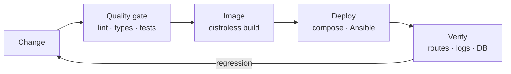

<!-- markdownlint-disable MD041 -- the profile header opens with the animated banner by design, not with a heading -->

  

  

<h1 align="center">
  
  Hi, I'm 4q4r!
</h1>

  

  I write production code through my own AI-agent delivery loop — <b>backend</b>, <b>infrastructure</b>, <b>security</b>. 
  Open to remote work, UTC+3

## 📑 Table of Contents

- [💫 About Me](#-about-me)
- [🚀 Areas of Interest](#-areas-of-interest)
- [🧰 Technology Stack](#-technology-stack)
- [🤖 AI & Data](#-ai--data)
- [🔐 Security Work](#-security-work)
- [🧭 How I Ship](#-how-i-ship)
- [📫 Contact](#-contact)

---

## 💫 About Me

> Backend Developer , I create high-performance APIs and automated solutions for **Telegram** and **VK**.

In my free time, I dive into the world of cybersecurity: analyzing malware, researching vulnerabilities, doing OSINT, and configuring secure infrastructure.

---

## 🚀 Areas of Interest

<table>
<tr>
<td width="50%">

🏗️ **Backend Architecture**
> Designing scalable and fault-tolerant services

🦠 **Malware Analysis**
> Analysis of stealers, RATs, ransomware, rootkits, and bootkits

🔓 **Penetration Testing**
> Web, WiFi, Bluetooth, SSH, ADB — from reconnaissance to exploitation

</td>
<td width="50%">

🕵️ **OSINT**
> Searching for people, analyzing leaks and social networks

🛡️ **Defensive Security**
> IDS/IPS, antivirus behavior analysis, detection bypass

🐧 **Linux & Dotfiles**
> Arch Linux + sway, desktop environment customization

</td>
</tr>
</table>

---

## 🧰 Technology Stack

<b>🧩 Languages & Backend</b>

 

<b>🗃️ Databases & Caching</b>

 

<b>⚙️ DevOps & Infrastructure</b>

 

**Serverless & edge:** `Cloudflare Workers` `D1` `KV` `R2`
**Delivery:** `Multi-node Ansible deploys` `CI/CD pipelines` `systemd units`

<b>🖥️ Operating Systems</b>

 

<b>🎨 Desktop Environment</b>

 

<b>🪟 Window Manager</b>

 

<b>🔌 Hardware</b>

 

---

## 🤖 AI & Data

<b>ML & Neural Networks</b>

 

**Vision:** `YOLO v6/v8/v11/v12`

**Retrieval:** `RAG (Elasticsearch + ChromaDB)` `Qdrant → Elasticsearch → reranker → PostgreSQL-only` `spaCy NER`

**LLM & agents:** `OpenAI API` `MCP servers` `Custom plugins` `Model catalog & routing`

**Built:** a RAG support bot — `aiogram` + `OpenAI API`, PDF ingestion, chunking, grounded answers.

---

## 🔐 Security Work

**Delivered engagements**

- **Web application penetration test** — 46 findings, 7 of them P1; report handed over.
- **Network measurement research** — a 21-page paper backed by 66 sources on traffic classification and censorship behaviour.

**Tooling**

<b>🔓 Penetration Testing</b>

 

<b>🦠 Malware Analysis & Reverse Engineering</b>

 

**Analyzed:** `Stealers` `Clippers` `Ransomware` `RATs` `Loaders` `Rootkits` `Bootkits`

**Formats:** `EXE` `MSI` `PDF` `DOC` `BAT` `SH` `Python (PyInstaller, Nuitka)`

<b>🕵️ OSINT</b>

 

**Directions:** `People Search` `Leak Analysis` `Social Networks` `Leaked Databases`

<b>🛡️ Defensive Security</b>

 

**Knowledge:** `Static AV Analysis` `Dynamic AV Analysis` `Detection Bypass` `IDS/IPS`

---

## 🧭 How I Ship

Every change takes the same path — no hotfixes typed straight onto the box.

- **Change** — one topic per branch, conventional commits, review before merge.
- **Quality gate** — linters, type checks and tests must be green; a failing gate blocks the merge.
- **Image** — distroless, non-root, reproducible builds.
- **Deploy** — Docker Compose or Ansible across nodes; secrets never baked into images.
- **Verify** — probe the deployed artifact: real routes, real logs, real rows.

---

## 📫 Contact

  

> [!IMPORTANT]
> 💡 I prefer to receive one message that clearly conveys the full essence of your question or proposal. Please do not start the conversation with "Hi" — get straight to the point. This saves both of us time.

---

  

