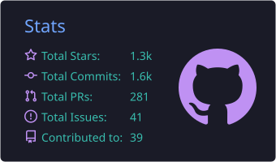

<!-- markdownlint-disable MD041 -->

  
  <h1>Hi, I'm 4q4r 👋</h1>
  
<b>I build production software through my own AI-agent delivery loop.</b> Backend · Infrastructure · Security

  Open to remote work · UTC+3
    
  

---

## ✦ GitHub activity

  
   
  
  &nbsp;
  

## ✦ A few things I've built

<!-- PROJECTS:START — generated from all current public repositories; edit config/projects.json, not this block. -->

<table width="100%" border="0" cellpadding="14" cellspacing="8">
<tr><td width="50%" valign="top"><a href="https://github.com/4q4r/tokenmill"><b>⌘ tokenmill</b></a> A public repository by 4q4r. ◉ Go　★ 1　⑂ 0</td><td width="50%" valign="top"><a href="https://github.com/4q4r/cindex"><b>⌘ cindex</b></a> A public repository by 4q4r. ◉ Go　★ 0　⑂ 0</td></tr>
<tr><td width="50%" valign="top"><a href="https://github.com/4q4r/Steam-Invertory-Helper-Tampermonkey"><b>⌘ Steam-Invertory-Helper-Tampermonkey</b></a> A public repository by 4q4r. ◉ JavaScript　★ 0　⑂ 0</td><td width="50%" valign="top"><a href="https://github.com/4q4r/p2p-utility"><b>⌘ p2p-utility</b></a> FastAPI-based application that provides functionalities for command execution, filesystem access, and video streaming ◉ Python　★ 1　⑂ 1</td></tr>
</table>

Randomly refreshed from the current public repository list · excludes are editable in <code>config/projects.json</code>.
<!-- PROJECTS:END -->

<!-- FOLLOWUP:START — workflow inserts this section only after a valid render. -->
<!-- FOLLOWUP:END -->

✦ More stats — open-source & anime

<table width="100%" border="0" cellpadding="10" cellspacing="0">
<tr>
<td width="50%" valign="middle" align="center">
  
</td>
<td width="50%" valign="middle" align="center">
  
</td>
</tr>
</table>

---

📫 Telegram: <a href="https://t.me/whynothacked">@whynothacked</a> — one message on the merits.

